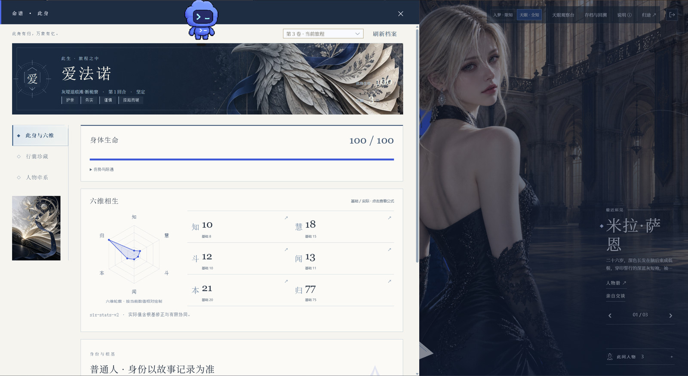
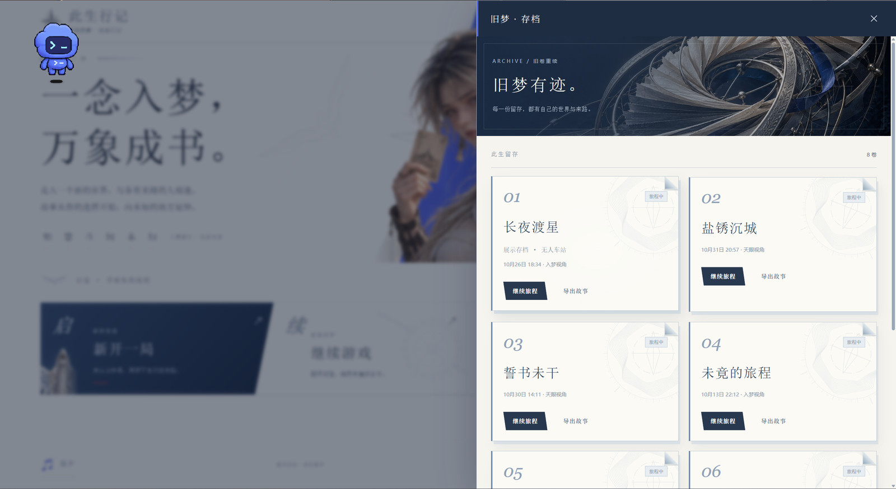
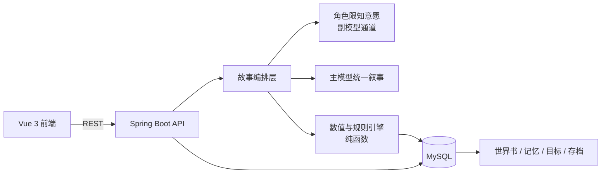

# 此生行记 · 动态互动叙事系统


一个由大语言模型驱动的中国神话互动叙事游戏。玩家以“凡人入梦者”的身份进入神明世界，用自由文本探索、交涉与对抗推动故事；系统实时生成古风叙事，并持续维护每个角色的**限知信息、记忆、目标**与**可回溯存档**。

前端 Vue 3 + Vite + Element Plus，后端 Spring Boot 3.3 + Java 17 + JPA + MySQL，模型层兼容 OpenAI 协议的 DeepSeek 通道。


## 界面预览

| 首页 · 入梦 | 故事舞台 |
|---|---|
|  |  |

| 命谱 · 六维 | 旧梦 · 存档 |
|---|---|
|  |  |

| 众生留影 · 图鉴 | 阅读偏好 |
|---|---|
|  |  |

| 配乐 | 主模型选择 |
|---|---|
|  |  |

> 截图取自实际运行的主舞台（`/play`），非设计稿。

## 这个项目想解决什么

把“AI 写故事”做成能长期玩下去的东西，难点从来不是单次生成，而是三件事：

1. **一致性**——三十回合之后，人物还认不认得出自己？场景里的东西还在不在？
2. **知情范围**——NPC 只应该知道自己该知道的事，否则“神明全知”直接把悬疑叙事杀死。
3. **可回溯**——故事必须能存、能读、能退回去重选，否则一次意外就毁掉整个存档。

本项目的答案是：**把叙事交给模型，把事实交给工程。** 模型负责“写得好看”，服务端负责“记得准确”——角色私密档案、世界书、场景图、事件流、数值结算全部落库，模型的每次输出都只是在这套事实之上的一次创作。

## 核心设计

### 一、故事优先的双通道叙事

常见做法是让每个 NPC 各调一次模型串行发言，代价是延迟随人数线性上升、文风互相打架、剧情容易散。本项目采用**主副双通道**：

- **副通道（角色模型）**：每个角色基于**自己的**私密档案、记忆与目标，产出一份「限知意愿」——他想做什么、为什么、是否在说谎。只输出意图，不写正文。
- **主通道（统一叙事）**：把玩家的行动、规则层的结算结果、各角色的意愿合并成一份上下文，由主模型一次性创作正文、对白与既成事实。

这样做的收益：**一次生成决定整段剧情**，风格统一、延迟可控；角色性格由副通道保证，不会被主模型“抹平”。

两个通道都做了**结构化解析 + 降级兜底**：模型返回非法 JSON 时不会中断游戏，而是回落到可继续的安全状态并记录日志。

### 二、限知视角与信息隔离

服务端按视角**裁剪返回内容**，而不是靠前端隐藏：

- **入梦人视角**：只看到叙事表层——你看到的、听到的、被告诉的。
- **天眼视角**：额外的 NPC 内心、持有的物品、记忆片段、判定依据、Token 与费用明细。

每个角色持有**独立的私密档案**，其决策上下文里不包含它不该知道的秘密。玩家想套话，就得靠「闻 + 慧」去打听，而不是直接读到答案。

### 三、六维属性与可复现结算

角色有六维属性：**知 / 慧 / 斗 / 闻 / 本 / 归**。每维包含基础值与加成，实际值按下式换算：

```
实际值 = ROUND(基础值 × (1 + 加成 / 100))
```

规则层（`engine` 包）以**纯函数**实现，不依赖 Spring 容器与数据库，因此可以脱离框架直接单测；同一份输入必然得到同一份结算结果，这保证了存档回溯后数值不会漂移。

### 四、世界书与自由探索

- **世界书**是公共事实层：地点、势力、传说、禁忌等条目化存储，供给模型作为世界观锚点。
- **场景图**以双向边连接，玩家输入「往北走」「穿过芦苇荡」这类自然语言，后端按当前场景查找出口；找不到就生成新场景并建立**双向连接**，保证来回走动时地理关系不穿帮。

### 五、记忆、目标与 NPC 群戏

NPC 不只是“会说话的道具”：

- 每个 NPC 有独立**目标**与**记忆**，目标达成/失败会改变其后续行为倾向；
- 每回合的决策单独落表（行为、台词、内心、是否说谎），便于复盘与调试；
- 群戏场景下多角色共享同一回合，由主模型统一调度出场顺序。

### 六、存档与检查点回溯

事件**按回合落库**，形成可回溯的事件流：

- 随时继续游玩；
- 回到任意历史回合重选（检查点回溯）；
- 死亡进入终局，可选择重开新的一世。

## 一次完整回合发生了什么

```
玩家输入
   │
   ├─1. 意图解析：识别动作类型（移动 / 交涉 / 对抗 / 观察 / 使用物品）
   │
   ├─2. 装配上下文：当前场景、在场角色、关系、背包、近期事件、相关世界书条目
   │
   ├─3. 规则结算（纯函数）：属性对抗、携物判定、可见性判定，产出可复现的依据
   │
   ├─4. 角色通道：各 NPC 依自身限知上下文产出「意愿 + 是否说谎」
   │
   ├─5. 主通道：合并上述事实，一次生成正文、对白、既成事实与新状态建议
   │
   ├─6. 一致性校验：结构化解析、物品与场景引用校验、异常降级
   │
   ├─7. 事务落库：回合事件、NPC 决策、状态变更、Token 与费用账本
   │
   └─8. 分层返回：按当前视角裁剪后交给前端渲染
```

## 技术栈

| 层 | 技术 |
|----|------|
| 前端 | Vue 3、Vite、Element Plus、Pinia、Vue Router |
| 后端 | Spring Boot 3.3、Java 17、Spring Data JPA、Jakarta Validation |
| 数据库 | MySQL 8（24 张表） |
| 模型 | DeepSeek（OpenAI 兼容协议），主 / 副双通道，可运行时切换模型 |
| 测试 | JUnit 5、Mockito、Vitest、Node Test、JaCoCo |
| 文档 | springdoc-openapi |

## 系统架构



分层依赖方向为 `web → service → engine / repository → domain`，规则层不反向依赖业务层，便于单测与替换。

## 数据模型（24 张表）

| 分组 | 职责 |
|---|---|
| 账号与会话 | 玩家、登录态、游戏会话、活动会话指针 |
| 叙事事件 | 回合事件、场景、场景连接、世界书条目 |
| 角色状态 | NPC 档案、六维数值、目标、记忆、每回合决策 |
| 物品与关系 | 背包、物品定义、人物关系与好感 |
| 运维账本 | Token 用量、调用费用、模型通道配置 |

## 项目规模

| 指标 | 数值 |
|---|---|
| 后端主代码 | 207 个类 / 21,261 行 |
| 后端测试 | 156 个测试文件 |
| 前端源码 | 106 个文件 / 47,502 行 |
| 数据表 | 24 张 |
| REST 接口分组 | 7 组（`/api/auth`、`/api/game` 及其子路径） |
| 自动化测试 | 后端 638 通过（4 跳过）+ 前端 405 通过 |

## 目录结构

```
BS/
├── backend/                 # Spring Boot 后端
│   ├── src/main/java/com/bs/narrative/
│   │   ├── domain/          # JPA 实体
│   │   ├── dto/             # 请求 / 响应对象
│   │   ├── engine/          # 纯函数数值与规则引擎
│   │   ├── exception/       # 全局异常与错误码
│   │   ├── llm/             # 模型通道、Prompt 与解析降级
│   │   ├── repository/      # 数据访问
│   │   ├── service/         # 业务编排
│   │   └── web/             # REST 接口
│   └── src/test/            # 单元与集成测试
├── frontend/                # Vue 3 前端
│   ├── src/                 # 页面、组件、状态与主题
│   └── tests/               # 前端测试
├── docs/                    # 设计、流程与验收记录
├── assets/                  # 美术与角色资源
└── scripts/                 # 启动与维护脚本
```

## 快速开始

### 环境要求

- Java 17+
- Maven 3.9+
- Node.js 18+
- MySQL 8+

### 1. 准备数据库

创建数据库 `bs`，并保证连接账号具备建表与读写权限。已有数据库不要执行 `sql/init-all.sql`（其中包含重建表语句）。

### 2. 配置环境变量

不要把密钥写进代码或提交到仓库。常用变量：

```powershell
$env:MYSQL_BS_PASSWORD="你的数据库密码"
$env:LLM_MAIN_API_KEY="主通道密钥"
$env:LLM_SUB_API_KEY="副通道密钥"
$env:LLM_MAIN_MODEL="主通道模型名"
$env:LLM_SUB_MODEL="副通道模型名"
```

本机也可使用 `.runtime/bs-local-secrets.yml`，该目录已被 Git 忽略。所有密钥均从环境变量或本地运行态读取。

### 3. 启动后端（默认 8090）

```powershell
cd backend
mvn '-Dmaven.repo.local=../.m2/repo' spring-boot:run
```

### 4. 启动前端（默认 5173）

```powershell
cd frontend
npm ci
npm run dev -- --host 127.0.0.1
```

浏览器打开 `http://localhost:5173`，首次使用先注册账号。

## 测试

```powershell
# 后端单元测试
cd backend
mvn test

# 后端集成测试（需要本机 MySQL，会写入数据库）
mvn '-Dmaven.repo.local=../.m2/repo' -Pintegration '-Djacoco.append=false' verify

# 前端测试与构建
cd frontend
npm test
node --test tests/*.test.mjs
npm run build
```

当前基线：**后端 638 个单元测试通过（4 个跳过），前端 405 个通过**，共 1043 条。

测试覆盖的重点是**可判定的部分**：数值结算、属性对抗、加权采样、携物判定、视角裁剪、解析降级、异常分支。叙事是否好看属于模型能力范畴，无法用断言衡量，只能靠实机试玩评估（见下节）。

## 工程实践

- **统一异常与错误码**：业务异常、参数校验、模型超时分别映射为固定错误码，前端可按码提示。
- **结构化日志**：每一回合记录模型通道、耗时、Token 用量与降级原因，便于定位“故事为什么走偏”。
- **Token 与费用账本**：每次调用落库，可查看单回合与整局成本。
- **OpenAPI 文档**：springdoc 自动生成，启动后可在线调试接口。
- **覆盖率统计**：JaCoCo 接入，测试与构建同一条命令完成。

## 叙事质量与当前边界

作者已做过完整的实机通关测试，结论如下：

**已达到的水平**——故事连贯性基本达到普通 AI 生成故事的水准。三十回合量级的游玩中，人物身份、已发生事件、场景地理、随身物品都能保持连续，不会出现“上一回合在东边、下一回合突然在西边”这类硬性崩坏。这是工程层（事实落库 + 视角裁剪 + 一致性校验）在起主要作用。

**仍然存在的问题**——AI 依然会出现**多描写**（该收的时候收不住）与**假性重复**（换个说法把同样的信息再说一遍）。这两类问题不是架构缺陷，而是**当前模型能力的边界**：在考虑成本的前提下，主流商用 API 还无法稳定处理过度复杂的多线情景，上下文一长就会倾向于用铺陈掩盖把握不足。

**框架侧的准备**——游戏框架本身是完整的：所有事实都在库里，模型只负责“怎么写”，不负责“记什么”。这意味着叙事质量的问题可以在**不重建系统**的前提下，通过换更强/更便宜的模型、调整上下文装配与压缩策略来逐步改善。模型迭代后，上述两类问题预计会大幅缓解。

换句话说：**现在的短板不在设计，而在模型；而设计的价值恰恰是让模型变强时能立刻吃到红利。**

## 后续规划

- 长程记忆的分层压缩，降低超长存档的上下文成本；
- 多结局与结局图鉴的完整闭环；
- 更细的 NPC 关系演化（信任、畏惧、亏欠）；
- 模型通道的自动择优（按回合复杂度路由到不同档位的模型）。

## 文档

- [系统完整流程](docs/毕设系统完整流程文档.md)
- [实现版本说明](docs/实施版本说明.md)
- [交付运行与维护](docs/交付运行与维护.md)

## 说明

- 本仓库不包含任何 API Key、数据库密码或论文正文。
- 代码与文档仅用于学习与交流，版权归作者所有。
- 仓库保留了一部分旧协议与兼容开关，用于回退路径与对照测试；当前主链路以“故事优先”流水线为准。
- 美术与音乐资源体积较大（约 246 MB），首次克隆较慢。

## 许可协议

本项目采用 [CC BY-NC-SA 4.0](https://creativecommons.org/licenses/by-nc-sa/4.0/deed.zh-hans) 许可协议：
**禁止商业使用**，转载或改编须署名作者并以相同协议共享。详见 [LICENSE](LICENSE)。

第三方美术素材、音乐与字体的版权归各自权利人所有，不在上述授权范围内。
