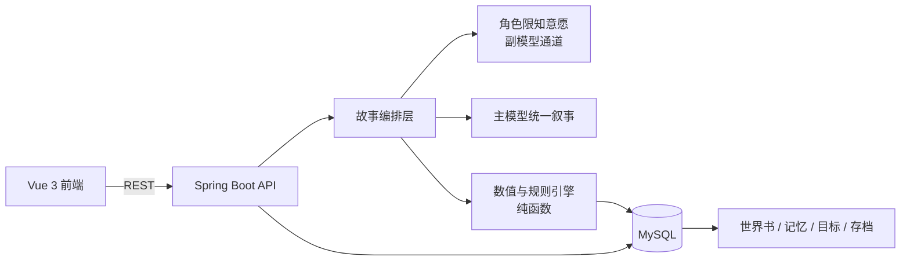

# 此生行记 · 动态互动叙事系统

一个由大语言模型驱动的中国神话互动叙事游戏。玩家以“凡人入梦者”的身份进入神明世界，通过自由文本探索、交涉与对抗推动故事；系统实时生成古风叙事，并维护每个角色的限知信息、世界书、目标与可回溯存档。

前端 Vue 3 + Vite + Element Plus，后端 Spring Boot 3.3 + Java 17 + JPA + MySQL，模型层兼容 OpenAI 协议的 DeepSeek 通道。


## 功能特性

- **故事优先的双通道叙事**：角色模型基于各自的私密档案、记忆与目标产出“限知意愿”，主模型统一创作正文、对白与既成事实，避免多角色串行调用带来的高延迟与叙事割裂。
- **六维数值体系（知 / 慧 / 斗 / 闻 / 本 / 归）**：包含成长曲线、感悟乘数、双属性协同与交手结算；规则层以纯函数实现，可脱离 Spring 与数据库单测。
- **限知 / 天眼双视角**：服务端按视角裁剪返回内容。入梦人只看到叙事表层，天眼可查看角色内心、物品、记忆、裁决依据与费用明细。
- **自由文本探索**：玩家输入“往北走”“穿过芦苇荡”等自然语言驱动移动，后端按场景图查找出口或生成新场景并建立双向连接。
- **世界书与检查点回溯**：事件按回合落库，支持继续游玩、回到指定回合、死亡终局与重开。
- **角色目标与群戏**：NPC 拥有独立目标、记忆与性格，按限知上下文自主决策，并记录每回合行为、台词、内心与是否说谎。
- **打听机制**：结果的可见范围、准确度与采样权重由“闻 + 慧”等属性共同决定。
- **工程化配套**：统一异常与错误码、结构化日志、OpenAPI 文档、Token 与费用账本、覆盖率统计。

## 技术栈

| 层 | 技术 |
|----|------|
| 前端 | Vue 3、Vite、Element Plus、Pinia、Vue Router |
| 后端 | Spring Boot 3.3、Java 17、Spring Data JPA、Jakarta Validation |
| 数据库 | MySQL |
| 模型 | DeepSeek（OpenAI 兼容协议），主 / 副双通道，可切换模型 |
| 测试 | JUnit 5、Mockito、Vitest、Node Test、JaCoCo |
| 文档 | springdoc-openapi |

## 架构概览



核心链路：

1. 玩家输入自由文本；
2. 解析意图与目标，读取当前场景、关系、背包与记忆；
3. 数值规则层给出可复现的结算依据；
4. 角色通道按各自限知上下文产出意愿；
5. 主模型生成完整叙事与既成事实；
6. 事务落库并返回结构化结果，供前端分层展示。

## 目录结构

```
BS/
├── backend/                 # Spring Boot 后端
│   ├── src/main/java/com/bs/narrative/
│   │   ├── domain/          # JPA 实体
│   │   ├── dto/             # 请求 / 响应对象
│   │   ├── engine/          # 纯函数数值与规则引擎
│   │   ├── exception/       # 全局异常与错误码
│   │   ├── llm/             # 模型通道、Prompt 与解析降级
│   │   ├── repository/      # 数据访问
│   │   ├── service/         # 业务编排
│   │   └── web/             # REST 接口
│   └── src/test/            # 单元与集成测试
├── frontend/                # Vue 3 前端
│   ├── src/                 # 页面、组件、状态与主题
│   └── tests/               # 前端测试
├── docs/                    # 设计、流程与验收记录
├── assets/                  # 美术与角色资源
└── scripts/                 # 启动与维护脚本
```

## 快速开始

### 环境要求

- Java 17+
- Maven 3.9+
- Node.js 18+
- MySQL 8+

### 1. 准备数据库

创建数据库 `bs`，并保证连接账号具备建表与读写权限。已有数据库不要执行 `sql/init-all.sql`（其中包含重建表语句）。

### 2. 配置环境变量

不要把密钥写进代码或提交到仓库。常用变量：

```powershell
$env:MYSQL_BS_PASSWORD="你的数据库密码"
$env:LLM_MAIN_API_KEY="主通道密钥"
$env:LLM_SUB_API_KEY="副通道密钥"
$env:LLM_MAIN_MODEL="主通道模型名"
$env:LLM_SUB_MODEL="副通道模型名"
```

本机也可使用 `.runtime/bs-local-secrets.yml`，该目录已被 Git 忽略。所有密钥均从环境变量或本地运行态读取。

### 3. 启动后端（默认 8090）

```powershell
cd backend
mvn '-Dmaven.repo.local=../.m2/repo' spring-boot:run
```

### 4. 启动前端（默认 5173）

```powershell
cd frontend
npm ci
npm run dev -- --host 127.0.0.1
```

浏览器打开 `http://localhost:5173`，首次使用先注册账号。

## 测试

```powershell
# 后端单元测试
cd backend
mvn test

# 后端集成测试（需要本机 MySQL，会写入数据库）
mvn '-Dmaven.repo.local=../.m2/repo' -Pintegration '-Djacoco.append=false' verify

# 前端测试与构建
cd frontend
npm test
node --test tests/*.test.mjs
npm run build
```

当前基线：后端 638 个单元测试通过（4 个跳过），前端 405 个测试通过。单元测试不代表完整叙事质量，真实模型下的故事连贯性仍需实际试玩验证。

## 文档

- [系统完整流程](docs/毕设系统完整流程文档.md)
- [实现版本说明](docs/实施版本说明.md)
- [交付运行与维护](docs/交付运行与维护.md)

## 已知限制

- 叙事质量依赖模型输出。工程侧通过上下文约束、结构化解析与降级兜底降低失败率，但长程故事仍可能出现重复线索或人物前后不一致。
- 仓库保留了一部分旧协议与兼容开关，用于回退路径与对照测试；当前主链路以“故事优先”流水线为准。
- 美术资源体积较大，首次克隆较慢。

## 说明

- 本仓库不包含任何 API Key、数据库密码或论文正文。
- 代码与文档仅用于学习与交流，版权归作者所有。
